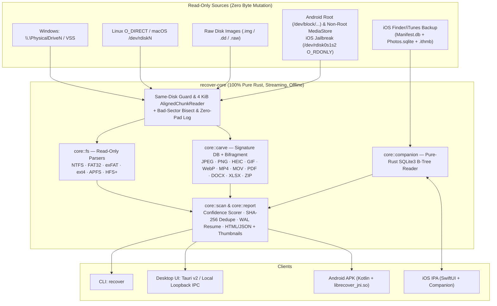

<div align="center">

# 🔍 Forensic Recover

**Offline, Read-Only Digital Forensics & Unallocated File Recovery Suite**

*Dual-engine filesystem metadata parsing + structural signature carving across Desktop (Windows / macOS / Linux), Android (Non-Root + Root JNI), and iOS (USB Backup Companion + Sandbox + Jailbreak).*

[](crates/recover-core)
[](#capability-matrix)
[](#forensic-safety-guarantees)
[](#forensic-safety-guarantees)
[](https://github.com/thanhduykx/forensic-recover/actions/workflows/ci.yml)
[](LICENSE)

[Quick Start](#-quick-start) • [Architecture](#-architecture) • [Capability Matrix](#-capability-matrix) • [Build from Source](#-build-from-source) • [Tiếng Việt](#-hướng-dẫn-nhanh--tiếng-việt)

</div>

---

> **⚠️ Critical Hardware Reality Notice (Flash / SSD / Mobile):**
> Modern SSDs and smartphones use flash memory with **TRIM / UNMAP**, **Wear-Leveling**, and per-file hardware encryption (**Android FBE** / **Apple SEP**). **Stop using the target device immediately** and **never write recovered files, checkpoints, or logs onto the source drive**. No software can decrypt or recover sectors already zeroed by TRIM or evicted from hardware keystores — Forensic Recover surfaces these realities transparently via **Confidence Scoring** (`High` / `Medium` / `Low`) and block anomaly diagnostics instead of making false 100% claims.

---

## ✨ What Makes Forensic Recover Different?

Most recovery tools either only inspect OS trash folders or blindly dump raw magic headers full of corrupt false positives. **Forensic Recover** is engineered around digital forensics principles:

- **🔒 Strictly Read-Only Source Guarantees**:
  - Opens raw block devices with zero write flags (`GENERIC_READ` + `FILE_FLAG_NO_BUFFERING` + VSS snapshot probing on Windows; `O_RDONLY | O_DIRECT` on Linux; `O_RDONLY` + `F_NOCACHE` on macOS).
  - Enforces **Same-Disk Guard** (checking physical drive extents on Windows and `st_dev` / `/proc/mounts` on Unix) so destination outputs can never overwrite the scanned drive.
  - Streaming **4 KiB page-aligned I/O** (`AlignedBuffer`) with sector-level **bad-sector bisect & zero-padding** — hardware read errors are skipped and logged without drifting byte offsets or crashing the scan.
- **🧠 Dual Recovery Engine (`core::fs` + `core::carve`)**:
  - **Read-Only Filesystem Parsers**: Reconstructs deleted names, parent paths, timestamps, and cluster/extent runs from **NTFS** (`$MFT`, USA fixup, variable-length Data Runs, `$Bitmap`, `$UsnJrnl:$J`), **FAT32** (`0xE5` + VFAT LFN), **exFAT** (`0x05`/`0x40`/`0x41`), **ext4** (`i_dtime` + `0xF30A` extents), **APFS** (`NXSB` Fletcher-64 + crypto detection), and **HFS+**.
  - **True Format & Structural Validators (Zero Extension Guessing)**: Every carved hit must pass real format verification before acceptance — **JPEG** (marker walk, corrupt EXIF tolerance, byte-stuffed entropy scan, pixel decode via `JpegDecoder`), **PNG** (chunk walk + per-chunk CRC-32 + zlib inflate), **HEIC / MP4 / MOV** (ISO-BMFF `ftyp`/`moov`/`meta`/`mdat` atom walk), **GIF**, **WebP**, **PDF** (`obj`/`xref`/`startxref`/`%%EOF`), and **ZIP / DOCX / XLSX** (Central Directory + EOCD + Deflate CRC-32 + OOXML manifest inspection).
- **🧩 2-Fragment Bifragment Gap Carving**: Automatically detects interrupted JPEG, PNG, and ZIP/OOXML streams across allocated barriers in unallocated space and splices valid 2-fragment payloads.
- **📊 Honest Confidence Scoring & Deduplication**: Scores every item (`High` / `Medium` / `Low`) from validator fidelity, contiguity, FS metadata correlation, bad-sector proximity, and TRIM zero-block ratio; deduplicates via **SHA-256** and supports crash-safe **WAL checkpoint / resume**.
- **📱 3-Client Ecosystem (100% Offline)**:
  - **Desktop**: `recover` CLI + 3-step Web/Tauri UI (`recover ui` local loopback IPC + Tauri v2).
  - **Android (`minSdk 26`)**: Jetpack Compose 3-step UI, `RecoveryForegroundService` (Doze-resilient), `MediaStore` (`IS_TRASHED` / `IS_PENDING` API 30+), `.trashed-*` / `LOST.DIR` / cache scanner, plus **Root (`su`/Magisk)** read-only imaging bridged to Rust `recover-core` via JNI (`librecover_jni.so` for `arm64-v8a` & `x86_64`).
  - **iOS (`iOS 15+`)**: SwiftUI 3-step client + **Desktop USB Companion** featuring a pure-Rust read-only SQLite3 B-Tree parser (`Manifest.db`, `Photos.sqlite` `ZTRASHEDSTATE=1`, `.ithmb` cache carving) and optional Jailbreak `O_RDONLY` `/dev/rdisk0s1s2` streaming.

---

## 🏗 Architecture



---

## 📋 Capability Matrix

| Platform & Mode | Raw Block Access | Deleted FS Metadata | Unallocated Carving | Realistic Recovery Expectation |
| :--- | :---: | :---: | :---: | :--- |
| **Desktop — HDD / USB / SD Card** | Yes (Admin/root) | NTFS, FAT32, exFAT, ext4, APFS/HFS+ | Full + Bifragment | **High** when sectors are not overwritten |
| **Desktop — SSD with TRIM** | Yes (Admin/root) | Yes (`$MFT`, `$UsnJrnl` often intact) | Limited by DZAT/TRIM | **Medium–Low** (prioritize VSS snapshots) |
| **Android — Non-Root (APK)** | No (SELinux) | No | Standalone files only | **Sandbox-limited** (`MediaStore.IS_TRASHED`, `.trashed-*`, `LOST.DIR`, caches) |
| **Android — Root (`su`/Magisk + JNI)** | Yes (`/dev/block/...`) | ext4 / FAT32 / exFAT | Full via `librecover_jni.so` | **High** on SD cards; **Low** on FBE `/userdata` once file keys are evicted |
| **iOS — Non-Jailbreak + USB Companion** | No | SQLite B-Tree (`Manifest.db`, `Photos.sqlite`) | `.ithmb` & backup blobs | **Best practical option** for unencrypted local backups & trashed `ZASSET` rows |
| **iOS — Sideloaded IPA** | No | No | App container / cache | **Narrow** (PhotoKit Recently Deleted, App Group, `URLCache`) |
| **iOS — Jailbreak (`/dev/rdisk0s1s2`)** | Yes (`O_RDONLY`) | APFS superblock | Yes (when keys exist) | **Low** on iOS 15+ user files due to Apple SEP per-file encryption |

---

## 🚀 Quick Start

### 1. CLI Usage (Windows / macOS / Linux)

```bash
# Inspect a disk, partition, or raw image read-only
recover inspect --source /dev/sdb

# Scan unallocated space for deleted JPEGs and PNGs, generate HTML/JSON report & safe exports
recover scan --source /dev/sdb --out /mnt/recovery_drive/out --types jpg,png

# Resume an interrupted scan from its WAL checkpoint
recover resume --out /mnt/recovery_drive/out

# Scan an unencrypted iOS Finder/iTunes backup folder
recover ios-backup --backup-dir ./ios_backup --out ./out_ios

# Launch the 3-step local offline Desktop UI & Companion IPC server
recover ui --port 1420 --dist apps/desktop/dist
```

### 2. Windows 1-Click Mode

Inside `dist/` (or after building):
- Double-click **`MO-UNG-DUNG.bat`** to scan disk images (`.img`/`.dd`), try the bundled `demo-sample.img`, or scan iOS backups via the browser UI.
- Double-click **`MO-UNG-DUNG-ADMIN.bat`** (elevated) to scan physical USB drives, SD cards, or hard drives directly.

---

## 🛠 Build from Source

### Rust Core, CLI & Tests
```bash
cargo test --workspace
cargo clippy --workspace --all-targets -- -D warnings
cargo build --release -p recover-cli
```

### Desktop 3-Step UI (Vite + Tauri v2)
```bash
cd apps/desktop
npm install
npm run build

# Run via built-in local offline UI server:
../../target/release/recover ui --port 1420 --dist dist

# Or package native Tauri v2 desktop binary:
cd src-tauri && cargo tauri build
```

### Android APK (Kotlin + Rust JNI `arm64-v8a` & `x86_64`)
```bash
rustup target add aarch64-linux-android x86_64-linux-android
cargo install cargo-ndk
cargo ndk -t arm64-v8a -t x86_64 -o apps/android/app/src/main/jniLibs build --release -p recover-jni

cd apps/android
./gradlew testDebugUnitTest assembleDebug
```

### iOS IPA (Swift 5.9+ / XcodeGen / Codemagic M2)
```bash
# On macOS with Xcode & XcodeGen (or trigger the included codemagic.yaml workflow):
cd apps/ios
xcodegen generate
xcodebuild clean archive \
  -project ForensicRecoverIOS.xcodeproj \
  -scheme ForensicRecoverIOS \
  -configuration Release \
  -sdk iphoneos \
  -archivePath "$PWD/build/ForensicRecoverIOS.xcarchive" \
  CODE_SIGN_IDENTITY="" CODE_SIGNING_REQUIRED=NO CODE_SIGNING_ALLOWED=NO
```
Sideload the packaged unsigned `.ipa` using **AltStore**, **SideStore**, **Sideloadly**, or **TrollStore**.

---

## ✅ Verified Quality & Forensic Guarantees

- **Zero Source Mutation**: Verified bit-for-bit (`SHA-256 before == SHA-256 after`) across corpus tests and CLI runs on [mini_deleted.img](crates/recover-core/tests/fixtures/mini_deleted.img).
- **Automated Test Coverage**:
  - **26 / 26 Rust workspace tests** passing (`recover-core` I/O & FS parsers, 9 real format validators, corrupt-EXIF JPEG tolerance, 2-fragment JPEG reassembly, bad-sector resilience, WAL checkpoint/resume, iOS SQLite backup recovery, `recover-jni` round-trip, and `recover-cli` local UI/security guards).
  - **8 / 8 Android JVM unit tests** passing (symlink-resolved `userdata` same-volume guard, JNI export checkpoint contract, foreground service `scanId` race safety).
  - **< 2% false-positive rate** verified against 120 adversarial spoofed headers; **> 90% recovery rate** on contiguous deleted JPEGs in formatted FAT32 corpus images.
  - **`cargo clippy --workspace --all-targets -- -D warnings`** passes with 0 warnings.

---

## 🇻🇳 Hướng dẫn nhanh — Tiếng Việt

1. **Ngừng ghi dữ liệu lên ổ/điện thoại cần cứu** ngay lập tức và chuẩn bị một **ổ đĩa đích khác** để lưu file khôi phục.
2. **Trên Windows**: Mở `MO-UNG-DUNG.bat` (quét file `.img` / sao lưu iPhone / thử với `demo-sample.img`) hoặc `MO-UNG-DUNG-ADMIN.bat` (quét trực tiếp USB / thẻ nhớ / ổ cứng).
3. **3 bước trên giao diện**: Chọn ổ nguồn (thư mục lưu sẽ tự gợi ý sang ổ khác an toàn) → Bấm quét → Xem trước thumbnail & bấm **Khôi phục** (không bao giờ ghi đè file cũ).
4. **Trên Android**: Cài `ForensicRecover-Android-JNI-debug.apk`, cấp quyền Ảnh/Video, bấm quét và lưu kết quả về `Downloads/ForensicRecover/`. Máy đã Root có thể quét sâu qua Rust JNI sang thẻ nhớ/USB ngoài.

---

## 📂 Repository Layout

```text
forensic-recover/
├── signatures/signatures.v1.json   # Versioned signature DB (header/footer + validator refs)
├── crates/
│   ├── recover-core/               # Pure-Rust forensic engine (io, fs, carve, companion, scan, report)
│   ├── recover-cli/                # `recover` CLI + offline local UI & USB companion HTTP IPC server
│   └── recover-jni/                # `cdylib` JNI bridge for Android Root carving & export
├── apps/
│   ├── desktop/                    # 3-step Vite + TypeScript UI & Tauri v2 backend (`src-tauri`)
│   ├── android/                    # Kotlin Jetpack Compose client (minSdk 26, ForegroundService, JNI)
│   └── ios/                        # SwiftUI client (iOS 15+, PhotoKit/Cache, Companion, Jailbreak)
├── .github/workflows/              # CI matrix & release artifact workflows
├── codemagic.yaml                  # macOS M2 unsigned IPA build workflow
└── LICENSE                         # MIT License
```

---

## 🤝 Contributing & Support

Contributions, format validators, additional filesystem parsers, and bug reports are very welcome!
If this project helped you recover data or learn digital forensics internals, consider giving it a **⭐ Star** on GitHub!
